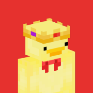
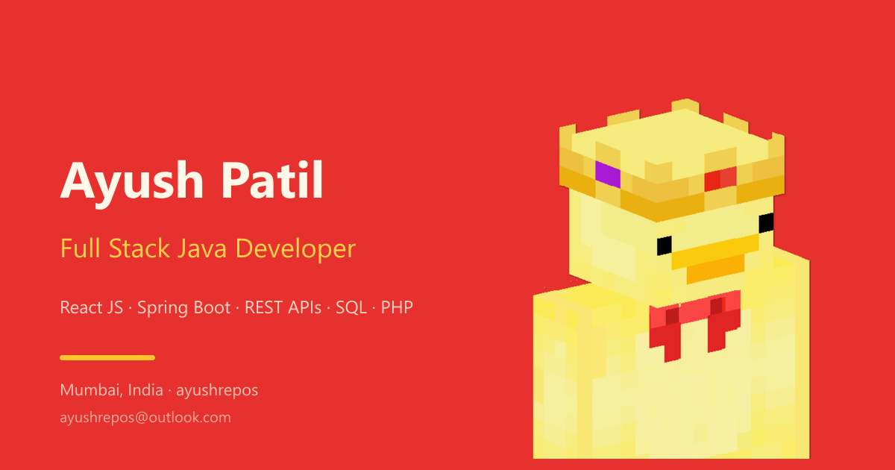

<p align="center">
  
</p>

<h1 align="center">Ayush Patil — Portfolio</h1>

<p align="center">
  <strong>Full Stack Java Developer · Computer Engineer · Mumbai, India</strong><br />
  A fast, accessible, red-and-yellow personal portfolio built with vanilla HTML, CSS and JavaScript.
</p>

<p align="center">
  <a href="https://ayushrepos.pages.dev/"></a>
  
  
  
  
  
  
</p>



## Overview

This is the personal portfolio of **Ayush Patil**, a Full Stack Java Developer and Computer Engineer based in Mumbai, India. It presents selected work, services, a searchable technology stack, an FAQ, a downloadable resume and a contact form hand-off — all in a single, dependency-free static site.

The design uses a warm red-and-yellow palette with a crowned pixel-art chicken as the brand mark. Both light and dark themes follow the visitor's device preference, and every interaction is built with progressive enhancement in mind.

**Live site:** [ayushrepos.pages.dev](https://ayushrepos.pages.dev/)

## Highlights

- **Responsive single-page layout** from 320px phones to wide desktops.
- **System-aware themes** — light/dark matches the device on load and updates live; the sun/moon toggle offers a manual override.
- **Resume download** from the hero card (`assets/Ayush-Patil-Resume.pdf`).
- **Selected work** with accessible project dialogs and technology tags.
- **Searchable stack** across frontend, backend and databases.
- **Accessible FAQ accordion** with proper `aria-expanded` state and keyboard support.
- **Discord username copy** with a toast confirmation.
- **Contact form** that validates and hands off to the visitor's email client.
- **Zero runtime dependencies** — no frameworks, no build step, no third-party scripts.
- **Local fonts and images** — the page makes no external requests at runtime.
- **Cloudflare Pages ready** with cache and security headers in `_headers`.

## Tech Stack

| Layer | Used |
| --- | --- |
| Markup | Semantic HTML5 |
| Styling | Modern CSS3, custom properties, fluid type, grid and flexbox |
| Behaviour | Vanilla JavaScript (ES5-compatible syntax, no libraries) |
| Fonts | Roboto Flex and Roboto Mono, self-hosted WOFF2 |
| Images | WebP with PNG fallbacks, responsive sizes |
| SEO | Canonical, Open Graph, Twitter cards, JSON-LD, `robots.txt`, `sitemap.xml` |
| Hosting | Cloudflare Pages |

## Project Structure

```text
.
├── index.html                  # Page markup, metadata and JSON-LD
├── styles.css                  # Theme system and responsive layout
├── script.js                   # Theme, menu, dialog, FAQ, search, toast, form
├── 404.html                    # Branded not-found page (served with a real 404)
├── _headers                    # Cloudflare Pages cache and security headers
├── robots.txt                  # Crawler rules and sitemap reference
├── sitemap.xml                 # Single-page sitemap
├── googleb57ade3d80d6a628.html # Google Search Console verification file
├── functions/
│   └── _middleware.js          # Exact-path 200 response for the verification file
├── _routes.json                # Runs the function only for the verification path
├── assets/
│   ├── logo.png / logo.webp    # Hero brand artwork
│   ├── mark.png / mark.webp    # Navbar mark
│   ├── favicon.png             # Browser icon
│   ├── apple-touch-icon.png    # iOS home-screen icon
│   ├── og.png                  # Social share card
│   └── Ayush-Patil-Resume.pdf  # Downloadable resume
└── fonts/
    ├── roboto-flex-latin.woff2
    └── roboto-mono-latin.woff2
```

## Run Locally

No installation or build step is required. Serve the folder with any static server:

```bash
python -m http.server 4173
```

Then open [http://127.0.0.1:4173/](http://127.0.0.1:4173/).

You can also open `index.html` directly, though a local server is recommended so fonts, caching rules and relative URLs behave like production.

## Performance

The site is intentionally lightweight:

- No frameworks, polyfills or third-party runtime requests.
- Hero and navbar artwork served as WebP with compressed PNG fallbacks.
- The hero logo is preloaded and marked high priority for the LCP.
- Fonts are self-hosted WOFF2 with `font-display: swap`.
- Images carry explicit dimensions to prevent layout shift.
- Cloudflare cache headers give assets and fonts long-lived caching.
- On a cold local load: roughly 127 KB of resources, ~100 ms DOMContentLoaded and ~172 ms LCP (local benchmark).

## SEO

- Canonical URL and absolute Open Graph/Twitter image URLs for `https://ayushrepos.pages.dev/`.
- Descriptive title, meta description, keywords and geo tags.
- JSON-LD `@graph` covering `Person`, `WebSite`, `ProfilePage` and `FAQPage`.
- `robots.txt` with sitemap reference.
- `sitemap.xml` ready for search-engine submission.
- Google Search Console verification file served with an exact-path `200` response, bypassing Cloudflare Pages' automatic `.html` → extensionless `308` redirect.
- `lang="en-IN"` and structured location, education and language data.

> If the site moves to a different domain, update the canonical, Open Graph/Twitter URLs, JSON-LD IDs, `robots.txt` and `sitemap.xml`.

## Contact

- **Email:** [ayushrepos@outlook.com](mailto:ayushrepos@outlook.com)
- **GitHub:** [github.com/ayushrepos](https://github.com/ayushrepos)
- **LinkedIn:** [linkedin.com/in/ayushrepos](https://linkedin.com/in/ayushrepos)
- **X:** [x.com/ayushrepos](https://x.com/ayushrepos)
- **Instagram:** [instagram.com/ayushrepos](https://instagram.com/ayushrepos)
- **YouTube:** [youtube.com/@ayushrepos](https://youtube.com/@ayushrepos)
- **Pinterest:** [pinterest.com/ayushrepos](https://pinterest.com/ayushrepos)
- **Discord:** `ayushrepos`

## Topics & Tags

`portfolio` · `personal-website` · `developer-portfolio` · `full-stack` · `java` · `spring-boot` · `react` · `nodejs` · `php` · `sql` · `rest-api` · `html5` · `css3` · `javascript` · `vanilla-js` · `responsive-design` · `accessibility` · `seo` · `json-ld` · `dark-mode` · `marathi` · `mumbai` · `cloudflare-pages`

---

<p align="center">© 2026 Ayush Patil · Mumbai, India</p>
